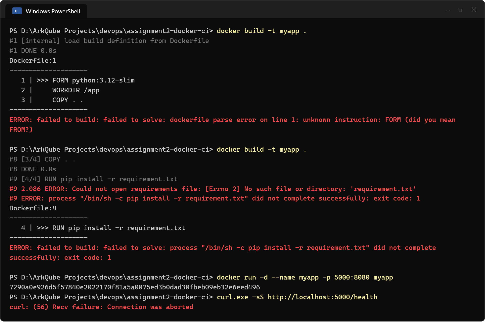
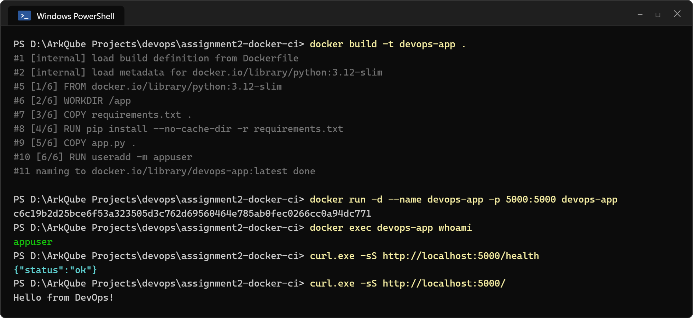

# Flask App with Docker and GitHub Actions


Simple Flask service (`/` and `/health`) packaged with Docker and checked on every push using GitHub Actions.

## Running Locally

Build and start the container:

```bash
docker build -t devops-app .
docker run -d --name devops-app -p 5000:5000 devops-app
```

Test the endpoints:

```text
$ docker run -d --name devops-app -p 5000:5000 devops-app
b407b0f19106677cd1916787e09c83b674a99c15e7c7446da292bf2e7aa1c25d

$ curl localhost:5000/health
{"status":"ok"}

$ curl localhost:5000/
Hello from DevOps!
```

Stop and clean up:

```bash
docker rm -f devops-app
```

## CI Workflow

`.github/workflows/build.yml` runs on every push and pull request:

1. Checks out the repository.
2. Builds the Docker image (`devops-app:ci`).
3. Starts the container on port 5000 and retries `curl -fs http://localhost:5000/health`, printing container logs if the check fails.

## Task 4: Bugs Found and Fixes

Teammate's Dockerfile and run command:

```dockerfile
FORM python:3.12-slim
WORKDIR /app
COPY . .
RUN pip install -r requirement.txt
CMD ["python", "app.py"]
```

```bash
docker run -p 5000:8080 myapp
```

Bugs and fixes:

1. **`FORM` typo instead of `FROM`** - Docker rejects line 1 at build time (`unknown instruction: FORM`). Fixed to `FROM python:3.12-slim`.
2. **`requirement.txt` missing the `s`** - `pip install` fails because the file in the repo is `requirements.txt`. Fixed to `RUN pip install -r requirements.txt` (using `--no-cache-dir`).
3. **Wrong container port in `-p 5000:8080`** - `-p HOST:CONTAINER` forwards host port `5000` to container port `8080`, while Flask listens on `5000`, so `curl localhost:5000/health` fails with a reset/aborted connection. Fixed to `docker run -p 5000:5000` and documented with `EXPOSE 5000`.

Beyond those three bugs, the `Dockerfile` here also copies `requirements.txt` before `app.py` for layer caching (instead of `COPY . .`) and switches to a non-root user.

### Before Fix (Teammate's Setup)



### After Fix (Working Container & `/health`)



## Bonus

- `.dockerignore` excludes `.git`, `.github`, `__pycache__`, and markdown files from the build context.
- Container runs as a non-root user (`appuser`) instead of `root`.
- CI workflow runs the built container and calls `/health`, failing the job if it doesn't respond.
